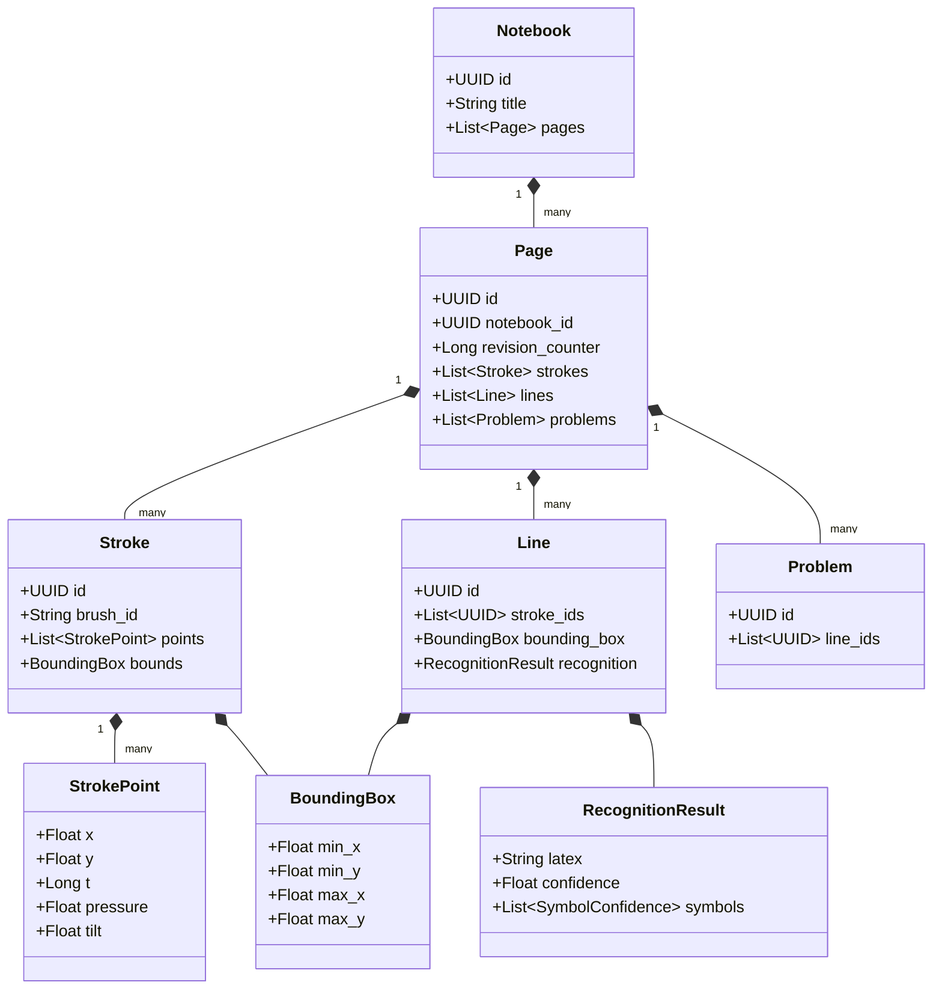
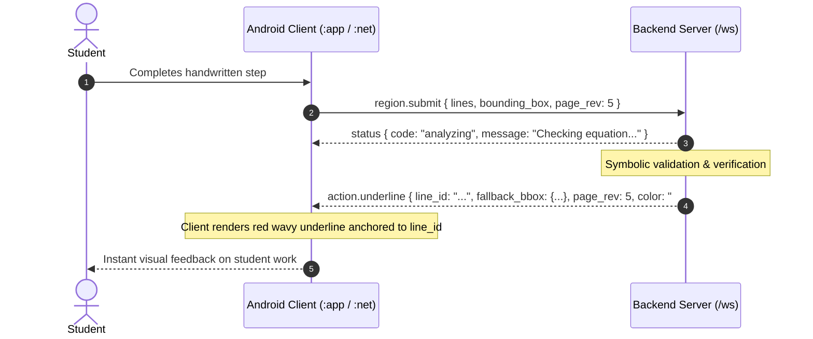

# System Architecture: Math Notebook AI Tutor

## 1. Overview and Principles

The Math Notebook AI Tutor is a native Android tablet notebook designed for stylus (S Pen) freeform mathematics with an agentic AI tutor backend. 

### Core Design Principles
- **Strict Separation of Concerns**: Clean isolation between networking, domain model, drawing (ink), recognition, and tutoring agents.
- **No Heavy Agent Frameworks**: Lightweight, composable orchestration without bloated runtime dependencies.
- **Everything Testable**: Protocol contracts, domain serialization, transformation math, and WebSocket interactions are covered by automated unit and contract tests on both backend and client.
- **Page-Space Coordinates**: All coordinates are maintained in **page-space units** (logical, resolution-independent), never physical screen pixels. Screen-to-page and page-to-screen transforms are isolated to the viewport rendering layer.
- **Non-Text Tutor Feedback**: The tutor responds with structured "canvas actions" (underlines, sticky notes) anchored to mathematical lines rather than conversational chat bubbles.

---

## 2. Monorepo Structure

```
├── /protocol                 # JSON Schema definitions (Single Source of Truth)
│   ├── data_model.schema.json
│   ├── envelope.schema.json
│   ├── message.schema.json
│   ├── payloads/            # Schemas for each message payload
│   └── fixtures/            # Valid and invalid message fixtures for contract tests
├── /android                  # Android client (Kotlin + Jetpack Compose, minSdk 30)
│   ├── app/                 # Main Android application & UI screens
│   ├── model/               # Pure Kotlin domain data models (shared types)
│   ├── net/                 # OkHttp WebSocket client & serialization
│   ├── ink/                 # Placeholder for stylus ink canvas (Phase 1)
│   └── recognition/         # Placeholder for stroke recognition (Phase 2)
├── /backend                  # Python backend (FastAPI, Uvicorn, WebSockets)
│   ├── protocol/            # Pydantic models matching /protocol JSON schemas
│   ├── server/              # FastAPI application & /ws endpoint
│   ├── verification/        # Symbolic verification (Phase 3 placeholder)
│   ├── rag/                 # Knowledge retrieval (Phase 3 placeholder)
│   └── agent/               # Tutor agent orchestration (Phase 3 placeholder)
├── /docs                     # Architecture & Protocol specifications
└── README.md                 # Setup & running instructions
```

---

## 3. Data Model

The domain data model establishes a strict hierarchical structure representing notebook contents.



### Definitions:
1. **Notebook**: Top-level container representing a document (`id`, `title`, list of `Page`).
2. **Page**: A single continuous writing canvas.
   - `id`: Unique identifier.
   - `notebook_id`: Parent notebook identifier.
   - `revision_counter`: Non-negative integer that **increments monotonically on every edit** (stroke addition, erasure, line clustering, problem assignment).
   - `strokes`: Ordered list of raw strokes.
   - `lines`: Groupings of strokes representing mathematical lines of reasoning.
   - `problems`: Groupings of lines representing self-contained exercises or proofs.
3. **Stroke**: An immutable sequence of sampled stylus points.
   - `id`: UUID.
   - `brush_id`: Identifier for the visual pen brush.
   - `points`: Ordered list of `StrokePoint` (`x`, `y`, `t` in ms, `pressure` in `[0.0, 1.0]`, `tilt` in degrees).
   - `bounds`: Bounding box of the stroke in page-space.
4. **Line**: A semantic line of handwritten math.
   - `id`: UUID.
   - `stroke_ids`: IDs of strokes belonging to this line.
   - `bounding_box`: Tight enclosing box in page-space.
   - `recognition`: Optional `RecognitionResult` containing parsed `latex` string, overall confidence, and per-symbol confidence ratings.
5. **Problem**: An ordered sequence of `line_ids` formulating a math problem and student steps.

---

## 4. Canvas Actions & Tutor Flow

Rather than conversational text, tutor agents provide situated feedback directly on the page:



### Stale Action Prevention
Because handwriting and edits occur concurrently with network round-trips:
- Every action returned by the backend carries the `page_rev` against which it was computed.
- If the client's current `page_rev` differs (e.g., student erased or edited the line while the request was in flight), the client can detect staleness and discard or revalidate the action.
- Every action anchors primarily to a `line_id` plus a `fallback_bbox` for spatial positioning when the line moves or re-clusters.
